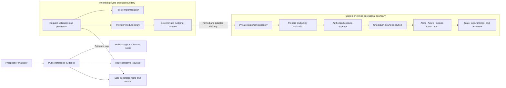

# Reference architecture

IMCLZ separates public evidence, private product engineering, and customer
operations. A production engagement imports a pinned operational release into a
customer-owned private repository; it does not operate from this public repo.

## Control flow

1. A customer request declares ownership, environment, cost allocation, data
   classification, region, and provider hierarchy inputs.
2. The private engine validates the request and deterministically renders
   provider-specific Terraform roots.
3. Terraform planning and policy evaluation occur before any write-capable
   execution stage.
4. An authorized approval binds execution to the reviewed saved-plan checksum.
5. Provider-specific identities operate only inside their intended boundary.
6. Evidence connects the request, generated root, plan, control result, cloud
   resources, findings, drift state, and teardown outcome.

The public package shows representative inputs, outputs, and results. The engine,
policy source, module library, trust configuration, and execution machinery are
withheld.
